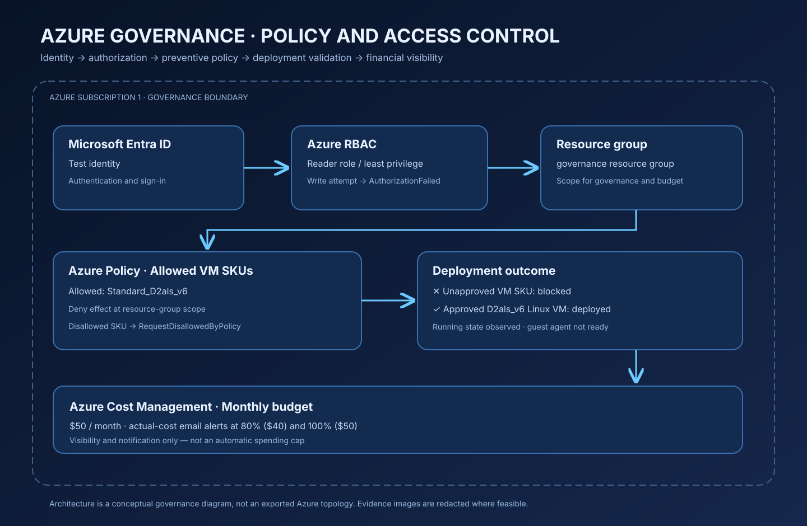
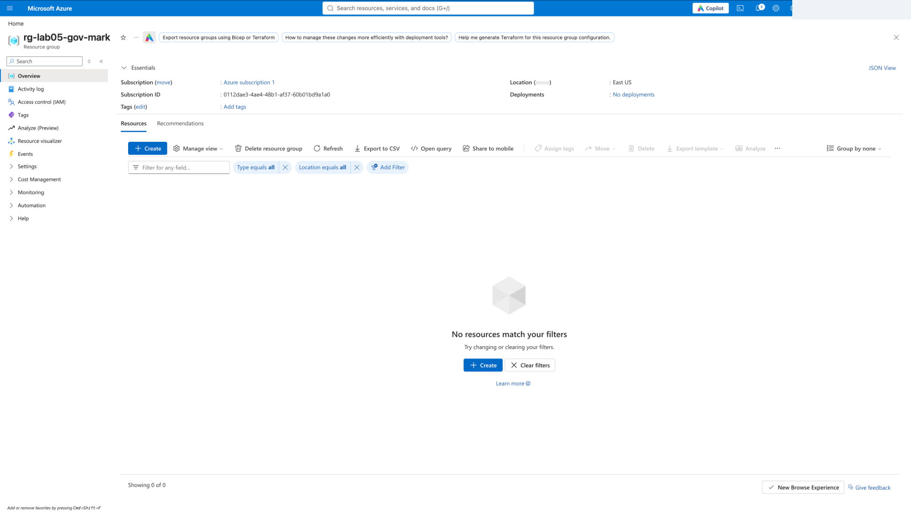
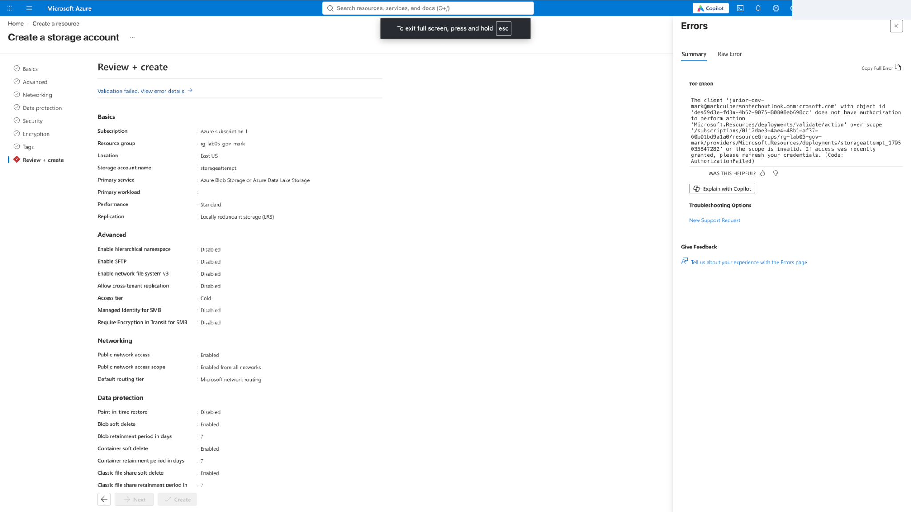
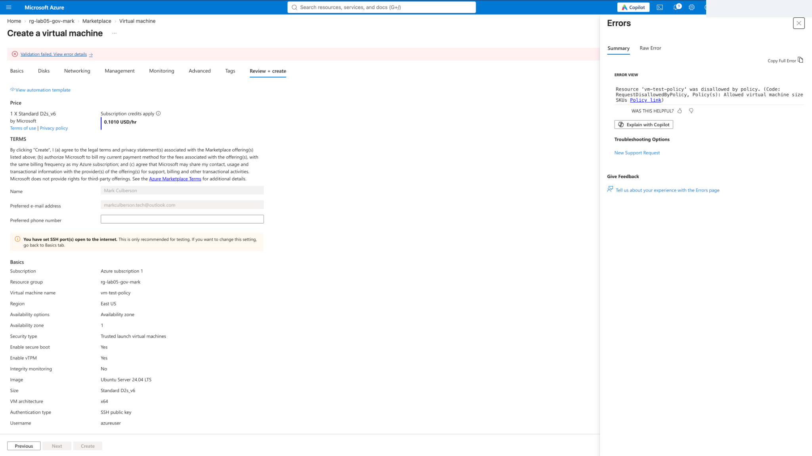
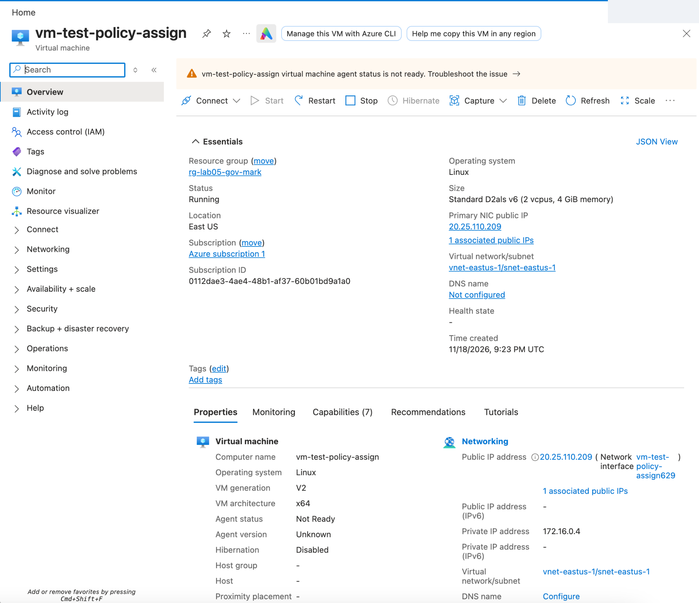
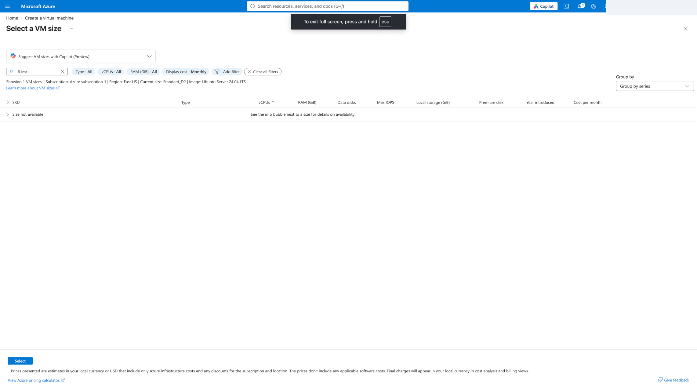
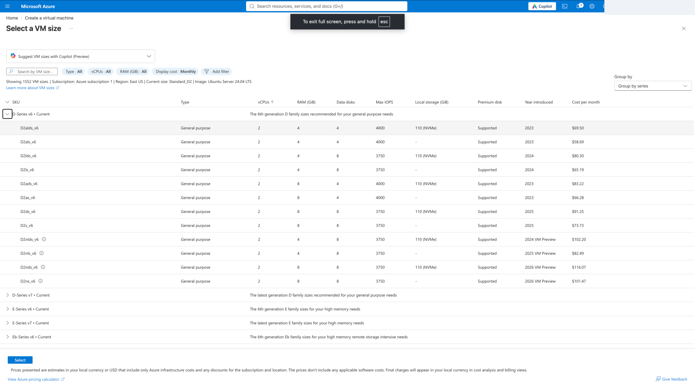
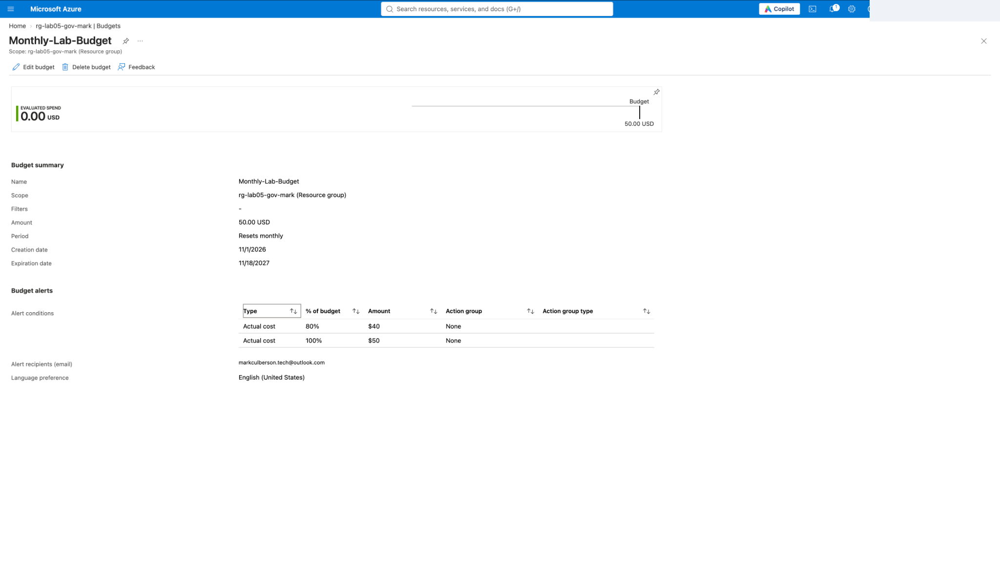

# ☁️ Azure Governance, RBAC, Policy Enforcement & Cost Management

> **Azure Portfolio Project | Identity & Access Management • Azure Policy • Cloud Governance • FinOps**

## Executive summary

This hands-on Azure project explored **authorization**, **resource governance**, and **cost visibility** using Microsoft Entra ID, Azure RBAC, Azure Policy, Azure Resource Manager, and Azure Cost Management. I documented both failed deployment attempts and a successful policy-compliant VM deployment.

**Observed outcomes:**
- A storage-account deployment validation failed with **`AuthorizationFailed`** for `Microsoft.Resources/deployments/validate/action` while using a restricted identity.
- Azure Policy rejected a VM size outside the approved list with **`RequestDisallowedByPolicy`**.
- After revising the allowed VM SKU to **`Standard_D2als_v6`**, an Ubuntu Linux VM was provisioned and showed **Running** in the Azure portal.
- A **$50 monthly resource-group budget** was configured with alerts at **80% ($40)** and **100% ($50)**.

> **Evidence standard:** Screenshots document what Azure displayed at capture time. A running VM does not independently prove successful SSH access or healthy guest agents. Budget alerts are notifications, not spending caps.

## Architecture

The [editable architecture diagram](assets/architecture.svg) depicts the documented governance relationships: identity and authorization, policy evaluation, deployment validation, and cost monitoring. It is a conceptual diagram, **not** evidence that every depicted component was independently tested.

## 1. Resource-group scope

The project was organized under **`rg-lab05-gov-mark`** in the **East US** region, using **Azure subscription 1**. Azure RBAC and Azure Policy apply at defined scopes; this project's VM-size policy assignment was scoped to the resource group.

## 2. Identity and Azure RBAC — authorization validation

A storage account creation attempt failed during deployment validation. The Azure error indicated the signed-in identity did not have authorization to perform **`Microsoft.Resources/deployments/validate/action`** at the target scope (`AuthorizationFailed`). This demonstrates an **authorization failure**, not an Azure Policy SKU denial.

**Interpretation:** Azure RBAC determines which operations a principal can perform. The failure alone does not verify the identity's entire role-assignment history or successful MFA setup; those require separate evidence.

## 3. Azure Policy — restrict VM sizes

I assigned the built-in **Allowed virtual machine size SKUs** policy to **`rg-lab05-gov-mark`**. Initially, I experimented with B-series sizes, but encountered availability and family-vCPU quota limitations. I then updated the permitted SKU list to **`standard_d2als_v6`** rather than disabling the policy.

### Actual policy assignment

The screenshot below shows the **Allowed virtual machine size SKUs** assignment and its permitted SKU parameter. It is **not** an auto-shutdown policy.

### Negative test vs. positive test

These are **two different screenshots from the documented project**, displayed together to demonstrate policy enforcement and compliant provisioning.

| ❌ Unapproved VM SKU → Azure Policy denial | ✅ Approved `D2als_v6` SKU → provisioned VM |
|:---:|:---:|
|  |  |
| **`Standard_D2s_v6`** — `RequestDisallowedByPolicy` | **`Standard_D2als_v6`** — Linux VM **Running** |

**What the comparison proves:** The rejected deployment violated the configured SKU restriction, while a VM with the permitted size was provisioned. The VM agent was **Not Ready** in the successful deployment screenshot; SSH connectivity and agent recovery were **not verified** by this evidence.

### VM sizing troubleshooting

An approved SKU is not automatically deployable: **Azure Policy**, **subscription quotas**, **regional capacity**, and **image compatibility** are separate checks. The B-series family quota screen and D-series catalog document the troubleshooting process, not additional successful deployments.

| B-series family quota limitation | D-series SKU options investigated |
|:---:|:---:|
|  |  |

## 4. Azure Cost Management — budget and alerts

I configured **`Monthly-Lab-Budget`**, scoped to the project resource group, for **$50 USD per month**, with actual-cost email alert thresholds at **80% ($40)** and **100% ($50)**.

**FinOps note:** An Azure budget **does not stop resources or prevent spending** when a threshold is reached. A running VM may continue generating charges until appropriately deallocated or deleted; related disks and public IPs can have separate charges.

## Troubleshooting lessons

1. **Distinguish permission failures from policy failures:** `AuthorizationFailed` and `RequestDisallowedByPolicy` indicate different control-plane checks.
2. **Separate governance from capacity:** A policy-compliant VM size may still be unavailable because of regional capacity or vCPU quota.
3. **Preserve the control:** Rather than removing the VM-size restriction, I adjusted the approved list to match a deployable D-series SKU.
4. **Verify outcomes with evidence:** The rejected deployment and running VM are captured separately and compared directly.
5. **Monitor cost without assuming enforcement:** Budgets provide cost awareness, not automatic shutdown.

## Evidence index

The [evidence folder](evidence/README.md) contains **eight screenshots** with descriptions of what each screenshot does—and does not—prove. Screenshots are provided for learning and portfolio review, not as a substitute for infrastructure-as-code or automated test results.

## Security and publication notes

- The running VM screenshot shows **agent status Not Ready** at capture time; do not claim guest-agent health or SSH connectivity was verified.
- The VM had a public IP during testing; production environments should restrict administrative access and consider Azure Bastion or just-in-time access.
- Azure Policy does not replace Azure RBAC or network controls.
- Review images for **subscription IDs, email addresses, public IP addresses, and other identifiers** before publishing publicly. No credentials or private keys should be included.

## Skills demonstrated

`Azure Policy` · `Policy Assignment` · `Azure RBAC` · `Microsoft Entra ID` · `Azure Resource Manager` · `Governance` · `VM SKU Restrictions` · `vCPU Quota Troubleshooting` · `Azure Linux VM` · `Azure Cost Management` · `Budget Alerts` · `FinOps` · `Cloud Security Validation` · `Technical Documentation`

## Future improvements / not yet evidenced

- Validate and document successful SSH access and guest-agent readiness.
- Capture cleanup/deletion confirmation and final cost review.
- Rebuild the policy and RBAC configuration using Terraform or Bicep with repeatable positive/negative tests.
- Restrict SSH ingress to trusted sources and reduce exposure of public IPs.

---

*Hands-on learning project; not a production-ready architecture.*
