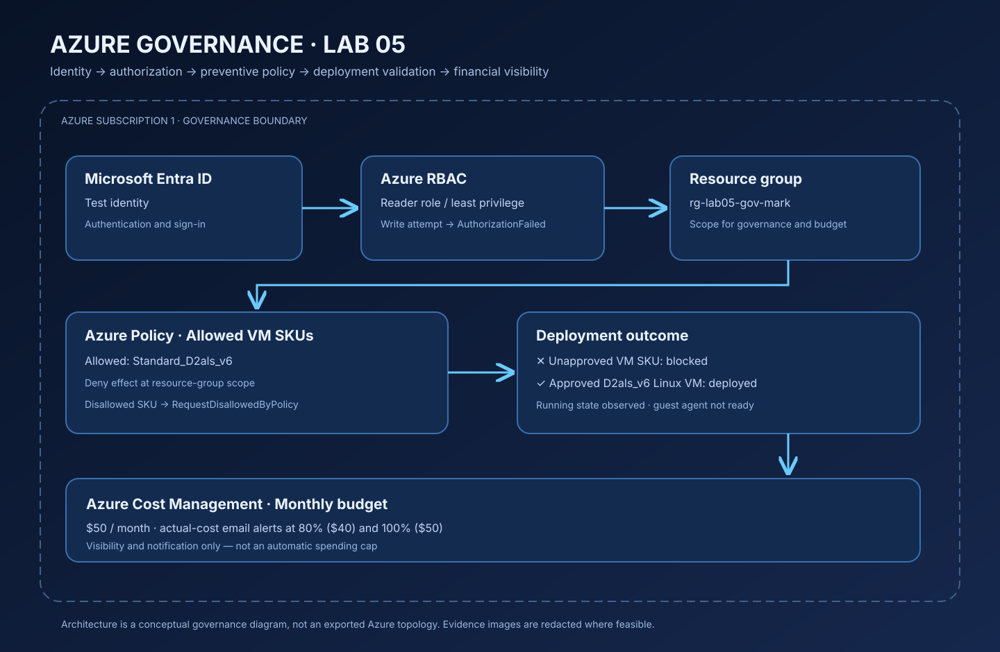
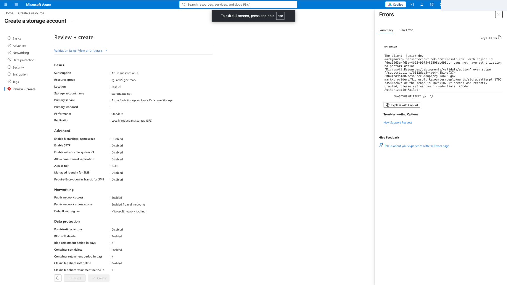
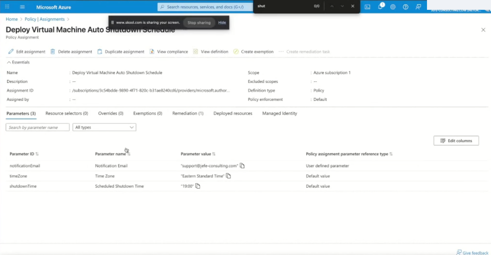
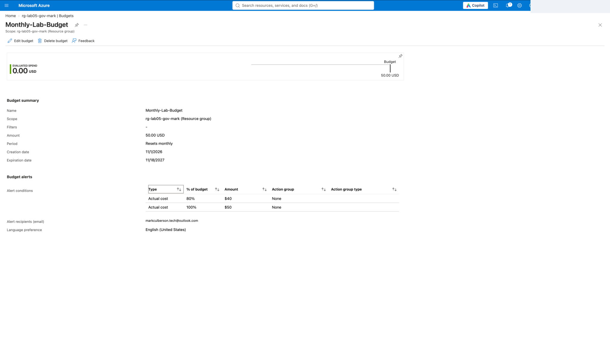

# ☁️ Azure Governance, RBAC, Policy Enforcement & Cost Management

> **Hands-on Azure Lab 05 | Identity & Access Management • Governance • Policy-as-Code Concepts • FinOps**

## Executive summary

Built and validated a governance-focused Azure lab using **Microsoft Entra ID**, **Azure role-based access control (RBAC)**, **Azure Policy**, and **Azure Cost Management**. The project demonstrates two distinct preventive controls: **authorization** (who can change resources) and **policy** (which resources are allowed to be deployed).

**Key result:** A restricted identity encountered an `AuthorizationFailed` deployment-validation error; a VM using a disallowed SKU was rejected with `RequestDisallowedByPolicy`; after updating the policy's allowed SKU and selecting a matching D-series size, a Linux VM was provisioned successfully.

## Architecture

The [editable SVG diagram](assets/architecture.svg) shows how identity, RBAC, resource-group policy, deployment validation, and cost monitoring interact.

| Control plane | Purpose | Observed evidence |
|---|---|---|
| Microsoft Entra ID | Test identity | Identity/access screenshots |
| Azure RBAC | Least-privilege Reader access | Role and authorization validation screenshots |
| Azure Policy | Restrict approved VM size SKUs | Assignment and denial screenshots |
| Azure Resource Manager | Validate/deploy compliant VM | VM deployment and overview screenshots |
| Azure Cost Management | Budget notifications | $50 budget with 80% and 100% actual-cost alerts |

## 1. Identity and access control

A test identity was used to validate authorization boundaries. The storage account creation flow failed at validation with **`AuthorizationFailed`** for `Microsoft.Resources/deployments/validate/action`. This is an **RBAC/authorization outcome**, not evidence of an Azure Policy deny. The screenshots demonstrate the failure, but do not independently establish every authentication/MFA step as completed.

## 2. Azure Policy — restrict VM sizes

Assigned the built-in **Allowed virtual machine size SKUs** policy to the lab resource group. Initially allowed B-series sizes, then adjusted the approved list to **`standard_d2als_v6`** after encountering B-series availability and quota constraints.

The disallowed **Standard D2s_v6** VM failed with **`RequestDisallowedByPolicy`**. After selecting the approved **Standard D2als_v6**, a Linux VM was created in **East US**. The VM overview showed **Running**, with **agent status Not Ready** at the time of capture. A running VM alone does not prove SSH connectivity or guest-agent health.

| Denied path | Allowed path |
|---|---|
| Unapproved VM SKU → Azure Policy denial | Approved D2als_v6 SKU → provisioned VM |
| [Policy denial](evidence/11-vm-policy-denial.png) | [Compliant VM](evidence/14-compliant-vm.png) |

## 3. Cost governance

Created a **$50 monthly budget** scoped to the lab resource group with **actual-cost email alerts at $40 (80%) and $50 (100%)**. A budget sends notifications; it **does not automatically stop, delete, or cap** running Azure resources.

## Troubleshooting and engineering decisions

1. **RBAC vs. policy:** Separated `AuthorizationFailed` (insufficient action permission) from `RequestDisallowedByPolicy` (resource configuration violates governance rules).
2. **SKU availability vs. policy compliance:** A size can be approved by policy but still unavailable due to capacity, subscription quota, region, or image compatibility.
3. **Controlled policy adjustment:** Updated the allowed SKU list to a deployable D-series VM size rather than disabling policy enforcement.
4. **Cost visibility:** Added a scoped budget and alert thresholds; would still stop/delete billable test resources when no longer needed.

## Evidence gallery

See **[evidence/README.md](evidence/README.md)** for the complete screenshot index and what each image proves. Screenshot evidence is **not** a substitute for repeatable infrastructure code; this lab was primarily configured and tested in the Azure portal.

## Security considerations

- **Reader** is a read-only Azure RBAC role, not a blanket denial of all authentication.
- **Azure Policy** is a preventive governance control, not a replacement for identity permissions or network security.
- A **public VM IP** was visible in the lab; restrict inbound SSH to trusted sources or use Azure Bastion/JIT access for real environments.
- **Budgets are alerts, not spending caps**; delete or deallocate resources deliberately.
- Review screenshot redactions before publishing; do not publish credentials, tokens, SSH keys, or sensitive tenant information.

## Skills demonstrated

`Azure Governance` · `Microsoft Entra ID` · `Azure RBAC` · `Least Privilege` · `Azure Policy` · `Policy Assignments` · `Azure Resource Manager` · `VM SKU / Quota Troubleshooting` · `Cost Management` · `FinOps` · `Security Validation` · `Technical Documentation`

## What I would improve next time

- Define role assignments and policy assignments declaratively with **Terraform or Bicep**, then validate in CI.
- Use a dedicated lab scope and explicit test cases for **allow / deny / insufficient permissions**.
- Configure budget automation separately if automatic remediation is desired; budget alerts alone do not shut resources down.
- Capture a successful guest connection/agent-health verification and a **cleanup screenshot** after teardown.

## Lab status

**Verified:** governance policy assignment, policy denial, compliant VM provisioning, budget alerts, and an authorization failure. **Not yet evidenced:** full cleanup, successful SSH connection, or guest agent becoming ready.

---

*Portfolio lab for learning and demonstration; not a production reference implementation.*
