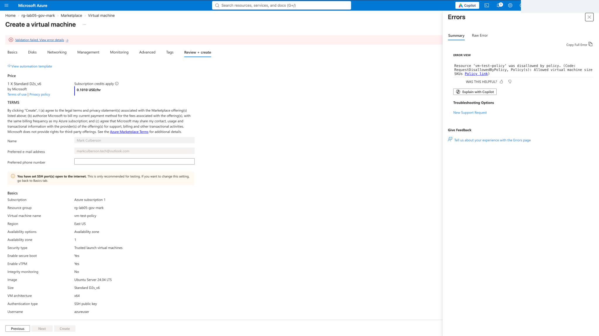
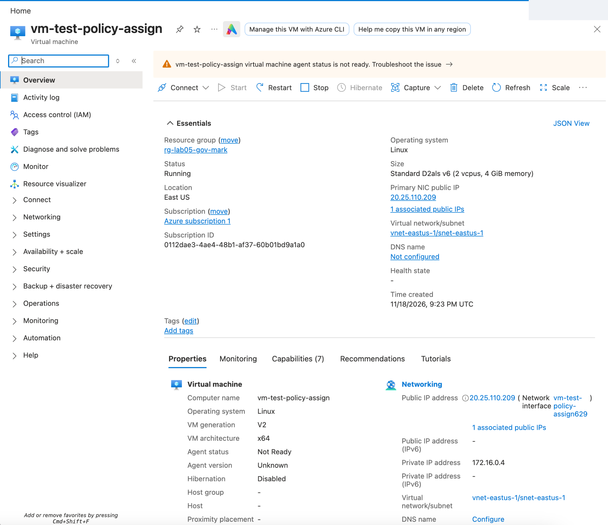

# Azure Governance — Screenshot Evidence

Seven project screenshots are included. The actual VM SKU policy assignment screenshot is pending; no unrelated auto-shutdown policy screenshot is substituted.

| File | Evidence |
|---|---|
| [01-resource-group-created.png](01-resource-group-created.png) | Resource group overview |
| [03-storage-deployment-authorization-denied.png](03-storage-deployment-authorization-denied.png) | AuthorizationFailed during storage deployment validation |
| [04-disallowed-vm-rejected-by-policy.png](04-disallowed-vm-rejected-by-policy.png) | RequestDisallowedByPolicy for unapproved VM size |
| [05-b-series-quota-limitation.png](05-b-series-quota-limitation.png) | B-series vCPU quota restriction |
| [06-d-series-sku-catalog.png](06-d-series-sku-catalog.png) | D-series VM sizing options |
| [07-compliant-linux-vm-running.png](07-compliant-linux-vm-running.png) | Approved D2als_v6 Linux VM running; agent Not Ready |
| [08-monthly-budget-alerts.png](08-monthly-budget-alerts.png) | $50 budget with 80% and 100% alerts |

## Denied vs approved

| Unapproved SKU — denied | Approved D2als_v6 — provisioned |
|:---:|:---:|
|  |  |
